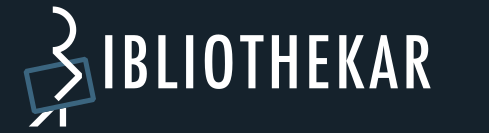

  
  
<strong>Self-hosted camera photo import, review and archival for TrueNAS</strong>

# Bibliothekar

**Bibliothekar** is a self-hosted web application for moving photographs from camera cards and other folders into a structured, long-term camera library. It emphasizes traceable file operations, preserving original media, keeping associated files together, and leaving decisions about the final archive to the user.

**Stable version:** 1.0.0 · **Image:** ghcr.io/heller-adrian/bibliothekar:1.0.0 · **License:** [AGPL-3.0](LICENSE)

Bibliothekar can run as a **TrueNAS Custom App** with Docker Compose. It has **not yet been accepted into the official TrueNAS Apps Catalog**; catalog submission and review are separate.

## Features

- **Import & Review:** inspect metadata and capture dates from SD-card backups, mounted removable devices or explicitly configured NAS folders.
- **Safe sourcing:** when the optional device helper is enabled, mount SD cards and USB media **read-only**; back up data before further organization.
- **File families:** keep related RAW, JPEG and sidecar files together.
- **Workspace:** assign media to dated events or a configurable **No Event** collection and preview file/folder operations before applying changes.
- **Metadata correction:** review and correct capture timestamps on verified working copies, including applying a consistent offset to groups.
- **Controlled archiving:** prepare a camera archive update and verify the actual file structure and event.json. Archive storage normally remains **read-only** to Bibliothekar.
- **Manual-change review:** detect external filename and event folder changes and handle them explicitly, including Accept/Undo for archived events.
- **Multiple libraries:** separate library databases and archive roots, with managed shared workspace inventories.

The UI supports English and German. Bibliothekar is a **file and event management application**, not a photo gallery or an AI sorter.

## A typical workflow

1. Attach an SD card or choose a saved backup/NAS source.
2. Create or review a verified backup; inspect media families and capture dates.
3. Assign files to events or leave them in **No Event**.
4. Review the planned folder structure and confirm the workspace operation.
5. Prepare a long-term archive change and manually perform the explicitly listed archive operations.
6. Return to Bibliothekar for verification, including the event.json. Unfinished actions remain visible under **Tasks**.

## Installation on TrueNAS

The [Compose example](compose.example.yaml) is a starting point for a TrueNAS **Custom App**. By default, it runs without Docker privileged mode and uses already available storage paths. The optional SD/USB device helper is disabled in the base profile.

Before installing:

1. Create dedicated datasets/directories for **app data**, **workspace** and **camera archive**, and ensure the correct filesystem/ACL permissions.
2. Set BIBLIOTHEKAR_APPDATA_DIR, BIBLIOTHEKAR_WORKSPACE_DIR and BIBLIOTHEKAR_MAIN_LIBRARY_DIR to their existing host paths.
3. Configure a strong BIBLIOTHEKAR_ADMIN_PASSWORD (at least 16 characters). Limit public access to the web UI.
4. Keep the archive mapping **read-only**, the workspace and app data **read/write**. Avoid mounting unrelated NAS datasets.
5. Deploy the Compose configuration and open the web UI on the selected port (default 30044).
6. Back up app data and the database before updates. Do **not** run two instances against the same SQLite database.

For reproducible installs use **ghcr.io/heller-adrian/bibliothekar:1.0.0**. The **ghcr.io/heller-adrian/bibliothekar:latest** tag follows the latest approved stable release. Pin a numbered tag or digest if rollback reproducibility matters.

### Container paths

| Container path | Purpose | Access |
| --- | --- | --- |
| /appdata | Settings, library databases, application state and recovery journals | Read/write; persistent |
| /workspace | SD backups, free media, event workspaces, metadata working copies and trash | Read/write; persistent |
| /main-library | Primary camera archive (other libraries have separate configured archive roots) | **Read-only** |
| /sources/nas | Optional NAS folder import source | Read-only |
| /tmp | Temporary runtime files | Disposable tmpfs |

Use the actual [Compose example](compose.example.yaml) for the authoritative environment variable names and host mappings. Internal paths below /appdata do not require separate host datasets.

### Optional automatic SD-card/USB mounting

Direct discovery, read-only mount and safe unmount of attached devices use a dedicated **source-helper process**. The optional [removable-device Compose overlay](compose.removable.yaml) currently enables Docker **privileged mode for the container**. The web process itself drops to UID/GID 568, but the container receives expanded device and mount permissions.

Enable this profile only as an informed administrator on a trusted host. Do not expose the source-helper service on a public port. The standard folder-based import profile does **not** require privileged mode. Fully automatic hardware hotplug under restricted device permissions is not yet qualified for the TrueNAS Apps Catalog.

## Data safety and operational notes

- Mount original camera media **read-only** wherever supported; keep camera archive mounts read-only in the recommended deployment.
- Bibliothekar uses SQLite, persistent operation journals and verification checks. **Never delete a recovery reservation merely to bypass a blocked action.**
- Changes involving the long-term camera archive deliberately require operator verification; the app does not silently modify that read-only mount.
- TrueNAS permissions, ACLs and selected host paths must be configured by the operator. Bibliothekar does not provision arbitrary host datasets.
- Device support depends on host Linux, filesystem, device exposure and permissions; unsupported or unverifiable devices are rejected.
- Use an HTTPS reverse proxy and appropriate network controls before making the web UI available remotely.

## Source, issues and license

Application code: [app](app/) · Tests: [tests](tests/) · Qualification: [qa](qa/) · Technical notes: [docs](docs/) · Downloads: [Releases](https://github.com/heller-adrian/Bibliothekar/releases).

For a public bug report, include the version, environment and reproduction steps, with **redacted** error messages. Do not upload private photos, databases, credentials or device IDs.

Bibliothekar is free software under the **GNU Affero General Public License version 3**. See [LICENSE](LICENSE).
